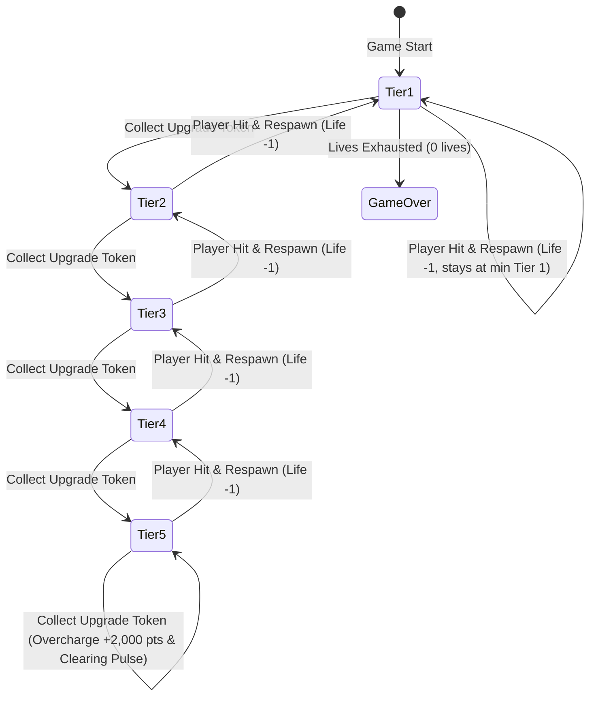

# Data Model: Modern 2D Web Game Visual & 5-Tier Weapon Overhaul

**Feature**: `003-visual-weapon-overhaul`  
**Status**: Completed  
**Prerequisites**: [spec.md](./spec.md), [research.md](./research.md)

---

## 1. Entity & Component Schema Extensions

### 1.1 `WeaponTier` & `WeaponTierConfig`

```typescript
export type WeaponTier = 1 | 2 | 3 | 4 | 5;

export interface WeaponStreamConfig {
  /** Offset X relative to ship center */
  readonly offsetX: number;
  /** Offset Y relative to ship center */
  readonly offsetY: number;
  /** Angle deviation in radians (0 = straight up) */
  readonly angle: number;
  /** Whether this stream has armor-piercing capabilities */
  readonly isPiercing?: boolean;
  /** Custom damage override for this specific stream */
  readonly damage?: number;
}

export interface WeaponTierConfig {
  readonly tier: WeaponTier;
  readonly name: string;
  readonly bulletSpeed: number;
  readonly cooldown: number; // seconds between volleys
  readonly baseDamage: number;
  readonly color: string;
  readonly glowColor: string;
  readonly bulletWidth: number;
  readonly bulletHeight: number;
  readonly streams: readonly WeaponStreamConfig[];
  readonly screenShakeIntensity: number; // 0 to 3 px
  readonly muzzleSoundFrequency: number; // Base frequency in Hz
}
```

#### Canonical 5-Tier Configurations

| Tier | Name | Color | Streams | Geometry | Damage / Shot | Special Property |
| :---: | :--- | :--- | :---: | :--- | :---: | :--- |
| **1** | Single Ion Needle | Cyan (`#00f0ff`) | 1 | $4 \times 16\text{px}$ focused bolt | 25 | Pinpoint accuracy |
| **2** | Twin Pulse Blaster | Emerald (`#00ff88`) | 2 | $6 \times 18\text{px}$ parallel dual bolts | 44 (2x22) | Lateral coverage |
| **3** | Tri-Beam Spread Cannon | Golden Amber (`#ffcc00`) | 3 | $8 \times 20\text{px}$ angled fan ($\pm 12^\circ$) | 60 (3x20) | Multi-lane suppression |
| **4** | Quad Plasma Annihilator | Electric Violet (`#bf55ec`) | 4 | $10 \times 24\text{px}$ plasma orbs + electric arcs | 88 (4x22) | High-density barrage |
| **5** | Omega Vanguard Hyper Beam | Solar Crimson (`#ff2a55`) | 5 | $14 \times 32\text{px}$ hyper beams + wing bolts | 120+ | **Twin Central Armor-Piercing Beams** |

---

### 1.2 `ProjectileComponent` & Armor-Piercing State

```typescript
export interface ProjectileComponent {
  sourceAffiliation: 'PLAYER' | 'ENEMY';
  damage: number;
  isPiercing?: boolean;
  /** Entity IDs already penetrated by this piercing bullet to prevent re-hitting in same frame */
  penetratedEntityIds?: number[];
}
```

**Validation & State Rules**:
- When `isPiercing` is `true`: On collision with an enemy ship, damage is applied and `penetratedEntityIds.push(targetId)`. The bullet is NOT recycled until it exits the screen boundary.
- When `isPiercing` is `false` or `undefined`: Standard behavior: bullet is recycled into pool immediately upon first collision.
- On pool release/reset: `penetratedEntityIds.length = 0`.

---

### 1.3 `ParallaxLayerState` & Background Elements

```typescript
export interface StarParticle {
  x: number;
  y: number;
  size: number;
  speed: number;
  brightness: number;
  color: string;
}

export interface NebulaNode {
  x: number;
  y: number;
  radius: number;
  colorStart: string;
  colorEnd: string;
  speed: number;
}

export interface ParallaxBackgroundState {
  distantStars: StarParticle[];  // ~80 stars, speed: 20-30 px/s
  nebulae: NebulaNode[];          // 4 radial celestial gas clouds, speed: 50-60 px/s
  foregroundDust: StarParticle[]; // ~35 particles + shooting stars, speed: 120-160 px/s
}
```

---

### 1.4 `EnemyColorTheme` & Visual Archetype Variants

```typescript
export interface EnemyVariantTheme {
  variantId: string;
  name: string;
  hullColor: string;
  wingColor: string;
  cockpitColor: string;
  thrusterFlameColor: string;
  sparkColor: string;
}

export interface ArchetypeColorCatalog {
  SCOUT: EnemyVariantTheme[];     // Emerald, Solar Amber, Toxic Lime
  FIGHTER: EnemyVariantTheme[];   // Hot Magenta, Crimson Orange, Cobalt Blue
  COMMANDER: EnemyVariantTheme[]; // Radiant Gold & Royal Purple
}
```

---

### 1.5 `PlayerVisualState` & Ship Banking Tilt

```typescript
export interface PlayerVisualState {
  currentTiltAngle: number;    // In radians, range: [-0.26, +0.26] (~ ±15 deg)
  targetTiltAngle: number;     // Set based on input dx
  recoilYOffset: number;       // Micro kickback displacement (0 to 3px)
  engineFlameLength: number;   // Dynamic thruster length (4 to 12px)
  wingVortexTimer: number;     // Speed streak emitter clock
}
```

---

### 1.6 `WeaponHUDState` & UI Visuals

```typescript
export interface WeaponHUDState {
  activeTier: WeaponTier;
  tierColor: string;
  tierName: string;
  upgradeFlashTimer: number;   // 0.5s highlight when tier ascends
  overchargeBadgeTimer: number;// 1.0s highlight when collecting bonus at Tier 5
}
```

---

## 2. Entity State Transitions



